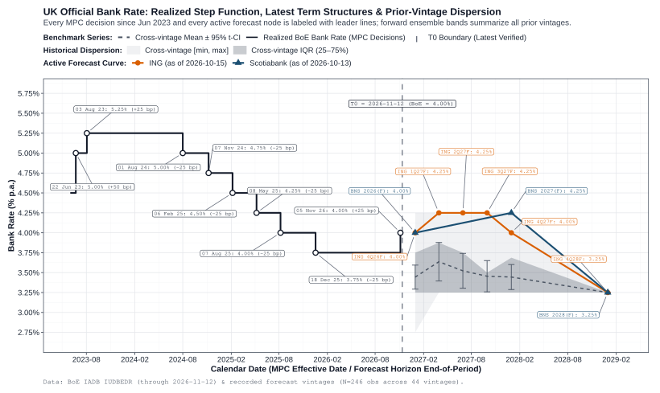
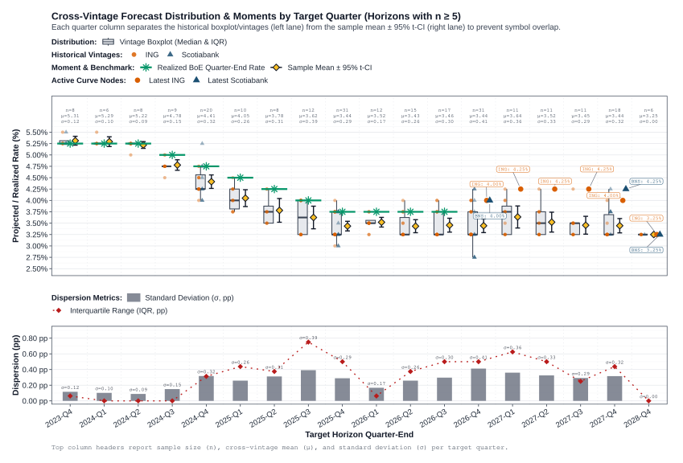
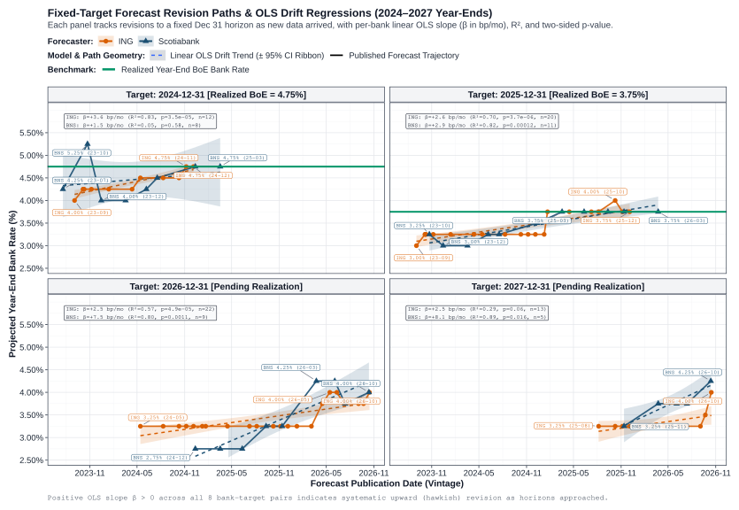
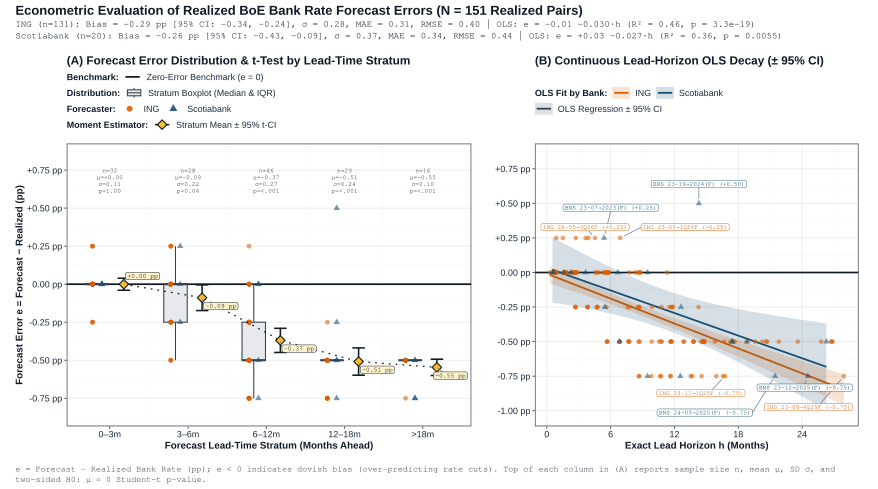

# boe-rate-forecast-tracker

Automated daily tracker and econometric visualization suite for **UK Bank of England (BoE) Official Bank Rate** forecasts (ING Think & Scotiabank Economics) compared against realized Monetary Policy Committee (MPC) policy decisions.

---

## 1. Realized Policy, Latest Term Structures & Prior-Vintage Dispersion

Realized BoE Bank Rate step function (`IUDBEDR`) with every MPC decision since June 2023, latest active ING and Scotiabank forecast term structures, and historical cross-vintage uncertainty bands (mean $\pm$ 95% $t$-CI, IQR, and `[min, max]`).

## 2. Cross-Vintage Forecast Distribution & Dispersion by Target Quarter

Per-quarter boxplots, historical vintage observations, sample mean $\pm$ 95% $t$-CI, and realized quarter-end Bank Rate, paired with cross-vintage standard deviation ($\sigma$) and interquartile range (IQR) dispersion metrics.

## 3. Fixed-Target Forecast Revision Paths & OLS Drift Regressions

Revision trajectories for fixed year-end targets (`2024-12-31` through `2027-12-31`) as each horizon approached, with per-bank linear OLS drift slopes ($\beta$ in bp/month), $R^2$, two-sided $p$-values, and 95% confidence bands.

## 4. Econometric Evaluation of Realized Forecast Errors

Stratified forecast error ($e = \text{Forecast} - \text{Realized}$, percentage points) boxplots with Student-$t$ $H_0: \mu = 0$ tests by lead-time stratum **(A)**, paired with continuous lead-horizon OLS error decay ($\pm$ 95% CI) **(B)**.

---

## Repository Structure & Data Ledgers

* **BoE Rate & Forecast Ledgers (Checked-In, Append-Only)**:
  * [`data/boe_base_rate.csv`](data/boe_base_rate.csv) — Official UK Bank Rate MPC step changes (`2020-01-02` onward) plus latest verified observation, sourced from BoE IADB (`IUDBEDR`) with `Bank-Rate.asp` HTML fallback (Open Government Licence v3.0).
  * [`data/boe_forecasts.csv`](data/boe_forecasts.csv) — Deduplicated, append-only UK Bank Rate forecast vintages from ING and Scotiabank (`2023-07-20` onward), dated using each bank's HTML publication banner.
* **Pipeline & Visualization Scripts**:
  * [`table-scrape.py`](table-scrape.py) — Extracts all HTML tables from `ing-forecasts.html` and `scotiabank-forecast-snapshot.html` into root `*.csv` files.
  * [`scripts/update_boe_tables.py`](scripts/update_boe_tables.py) — Enforces strict upstream schema invariants (failing loud in GitHub Actions if table indices, headers, or vintage banners drift) and appends new UK forecast curves and MPC rate changes to `data/`.
  * [`scripts/generate_plots.R`](scripts/generate_plots.R) — Renders the four `ggplot2` (`>= 4.0`) figures into `plots/` (`.svg` and 300-DPI `.png`) reading exclusively from `data/*.csv`.
* **Raw Upstream Snapshots**:
  * ING Policy Rates: [`ing-forecasts_2.csv`](ing-forecasts_2.csv) (from `2026-06-12`; previously `ing-forecasts_3.csv`)
  * Scotiabank Policy Rates: [`scotiabank-forecast-snapshot_1.csv`](scotiabank-forecast-snapshot_1.csv)
